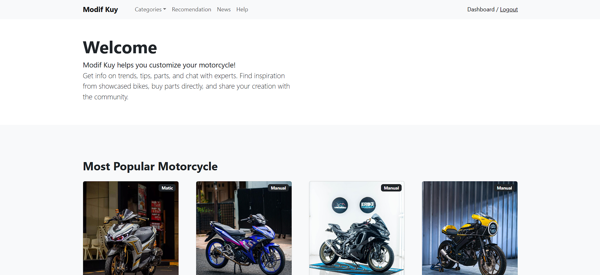
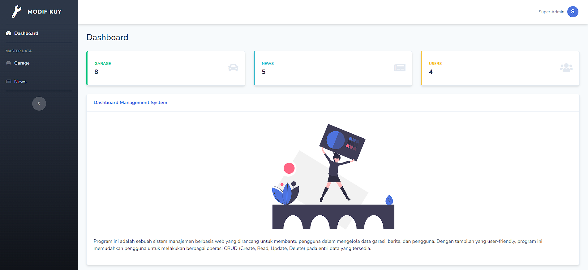

# 🏍️ Modif Kuy

Modif Kuy adalah aplikasi web untuk membantu pecinta motor memodifikasi motornya. Pengunjung bisa mencari inspirasi dari motor modifikasi (garage) yang dipamerkan, melihat daftar part yang dipakai, dan membaca info tren serta tips. Admin mengelola seluruh konten lewat dashboard.

## ✨ Fitur

**Halaman publik**
- Katalog garage dengan kategori **Matic** dan **Manual**
- Bagian *Most Popular Motorcycle* di halaman depan
- Halaman detail garage dengan galeri foto dan daftar modifikasi
- Menu Categories, Recommendation, News, dan Help
- Registrasi dan login pengguna

**Dashboard admin**
- CRUD garage (gambar utama, judul, kategori, deskripsi)
- Tambah, ubah, dan hapus foto tambahan untuk tiap garage
- Akses dibatasi berdasarkan role (`admin`)

## 🖼️ Screenshot

| Halaman Depan | Dashboard Admin |
|---|---|
|  |  |

## 🛠️ Tech Stack

- [Laravel 11](https://laravel.com) (PHP 8.2+)
- MySQL
- Bootstrap
- [SB Admin 2](https://startbootstrap.com/theme/sb-admin-2) untuk tampilan dashboard
- Laravel Mix (webpack) untuk build aset
- Laragon 

## 📋 Kebutuhan Sistem

- PHP >= 8.2 dengan ekstensi: Ctype, cURL, DOM, Fileinfo, Filter, Hash, Mbstring, OpenSSL, PCRE, PDO, Session, Tokenizer, XML
- Composer
- Node.js dan npm
- MySQL / MariaDB

## 🚀 Instalasi

1. Clone repository dan masuk ke foldernya
   ```bash
   git clone https://github.com/vitoagatha/app-modifkuy.git
   cd app-modifkuy
   ```
2. Install dependency
   ```bash
   composer install
   npm install
   npm run dev
   ```
3. Salin file environment dan generate key
   ```bash
   cp .env.example .env
   php artisan key:generate
   ```
4. Buat database kosong di MySQL, lalu atur koneksinya di `.env`
   ```env
   DB_DATABASE=nama_database
   DB_USERNAME=root
   DB_PASSWORD=
   ```
5. Jalankan migrasi
   ```bash
   php artisan migrate
   ```
6. Buat symlink storage (wajib agar gambar tampil)
   ```bash
   php artisan storage:link
   ```
7. Jalankan aplikasi
   ```bash
   php artisan serve
   ```
   Lalu buka `http://127.0.0.1:8000`. Kalau memakai Laragon, aplikasi otomatis tersedia di `http://nama-folder.test`.

## 🔑 Membuat Akun Admin

Buat akun admin lewat Tinker:

```bash
php artisan tinker
```
```php
\DB::table('users')->insert([
    'name' => 'Super',
    'last_name' => 'Admin',
    'username' => 'admin',
    'email' => 'admin@example.com',
    'password' => \Hash::make('ganti-password-ini'),
    'role' => 'admin',
    'created_at' => now(),
    'updated_at' => now(),
]);
```

Lalu login dengan email dan password tersebut. Segera ganti password setelah masuk.

## 🙏 Credits

- [Laravel](https://laravel.com)
- [SB Admin 2](https://startbootstrap.com/theme/sb-admin-2) oleh Start Bootstrap
- [LaravelEasyNav](https://github.com/ldumitru/laravel-easy-nav)

## 📄 Lisensi

Dirilis di bawah lisensi [MIT](LICENSE).